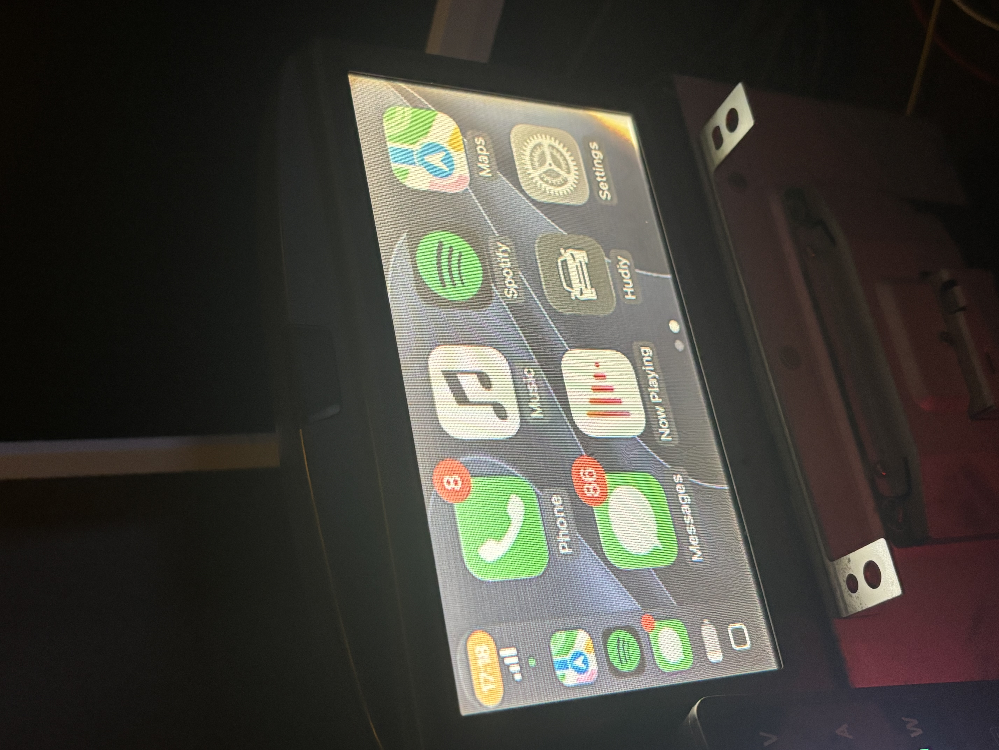
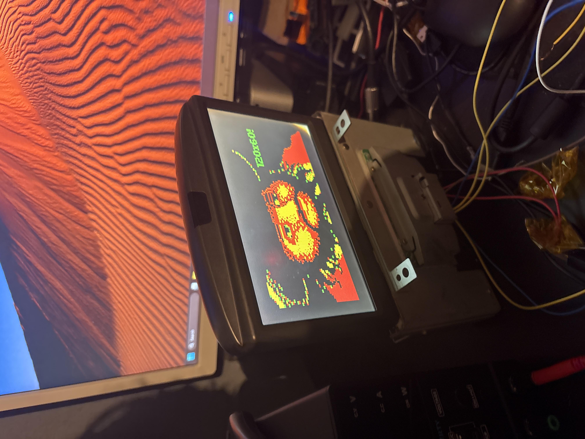

# Volvo-RTI-carplay-retrofit-with-hudiy
## THIS PROJECT IS A PLACEHOLDER FOR NOW. 

### How to get the RGB input to work?
Due to the very small screen size (400x234) of the RTI and composite sync VGA would normally not work. But after testing I found out that combining hsync and vsync together that the RTI accepts the signal. But the screen was still a mess because the display received an too heigh resolution. I use an hdmi to vga adapter and it doesn't support a resolution of 400x234 because the adapter doesn't accept an too low frequency. So I found a workaround. By changing the width to 1600 it changes the frequency above the minimal required for the adapter, which allowed it to display it. But this made the displayed image very squished. So Hudiy is launched with a scale of 0.25x using X11. 

The timings required for making the display work:

Horizontal Resolution = 1600px
Horizontal Sync Polarity = Positive
Horizontal Front Porch = 64
Horizontal Sync Pulse Width = 128
Horizontal Back Porch = 192

Vertical Resolution = 234px
Vertical Sync Polarity = Positive
Vertical Front Porch = 8
Vertical Sync Pulse Width = 3
Vertical Back Porch = 17

Refresh Rate = 60HZ
Pixel Clock = 31.19MHz

### Test with CarPlay using an Carlinkit CPC200-CCPA dongle with Hudiy:

### Currently playing song showing on stereo, scrolling text is a feature for long song titles: 

### RGB test for display using an Arduino: 

