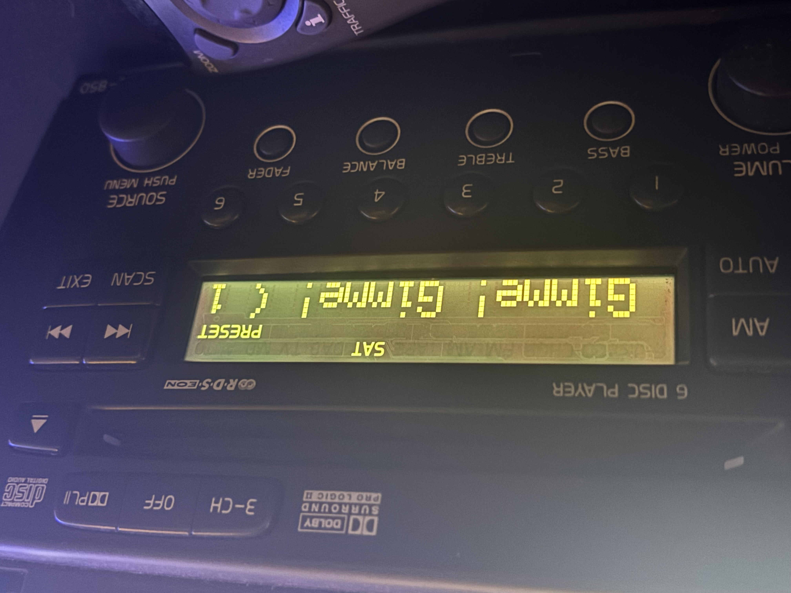

# Volvo-RTI-carplay-retrofit-with-hudiy
## THIS PROJECT IS A PLACEHOLDER FOR NOW. 

### Test with CarPlay using an Carlinkit CPC200-CCPA dongle with Hudiy:

### Currently playing song showing on stereo, scrolling text is a feature for long song titles: 

### RGB test for display using an Arduino: 

